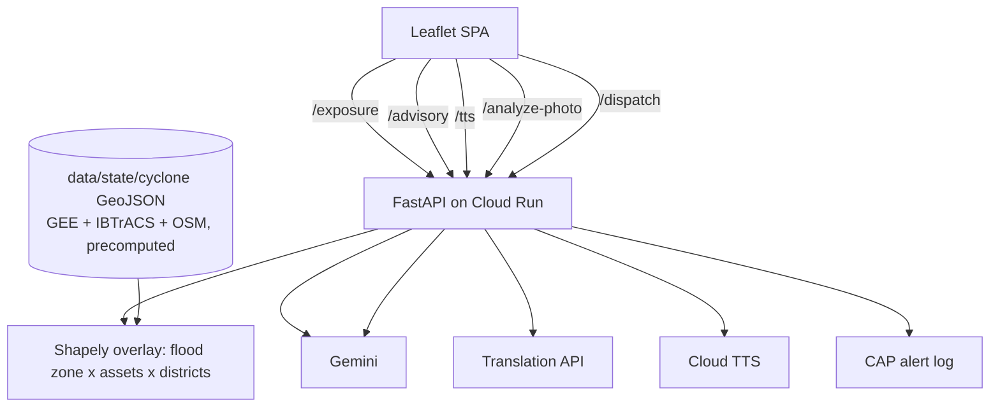

# 🛡️ Cyclone Shield
Anticipatory cyclone risk & multilingual early-warning platform for India's coast (Digital Public Good).
Simulate flood zone → map exposed power / roads / hospitals / shelters → Gemini risk ranking & CAP-style advisories → Translation API + TTS → dispatch.

## Google AI used
| Service | Role |
|---|---|
| Gemini (structured JSON) | District risk ranking + per-authority advisories + CAP alert |
| Gemini multimodal | Field-photo damage classification |
| Cloud Translation API | Advisories → Odia / Telugu / Bengali (Gemini as backup) |
| Cloud Text-to-Speech | Audio advisories (Telugu, Bengali, Tamil, Hindi, English; Odia not supported by Cloud TTS) |
| Cloud Run | Deployment |

## Architecture


## Modes
- **Replay:** 10 historical cyclones across 6 states (Odisha, Andhra Pradesh, West Bengal, Tamil Nadu, Gujarat, Maharashtra) — flood zone x assets overlay.
- **🔴 Live forecast (72h):** Open-Meteo wind-gust + rainfall forecast at every asset, hazard levels mapped to IMD wind/rain classes; active cyclones near India from GDACS. Includes a "what-if 2x stress test" for demos when the weather is calm. Not an official warning; IMD remains the authority.

## Run locally
```bash
python -m venv venv && source venv/bin/activate      # Windows: venv\Scripts\activate
pip install -r requirements.txt
cp .env.example .env    # then export the vars (or: export $(grep -v '^#' .env | xargs))
gcloud auth application-default login                # for Translation + TTS
python main.py          # http://localhost:8080
```
Without any keys the app still runs using data-driven fallbacks (banner shows the engine used).

## Deploy (Cloud Run)
```bash
gcloud run deploy cyclone-shield --source . --region asia-south1 --allow-unauthenticated \
  --set-env-vars GEMINI_MODEL=gemini-2.5-flash --set-secrets GEMINI_API_KEY=gemini-key:latest
```
Enable APIs: Cloud Run, Cloud Build, Translation, Text-to-Speech. Grant the Cloud Run service account access.

## Add a new state (no code changes)
1. Add an entry in `config/states.json` (language, districts, center, SDMA contact).
2. Add `data/<state>/<cyclone_id>/{districts,flood_zone,assets,track}.geojson`.

## Real data (one command per cyclone)
```bash
pip install -r scripts/requirements-data.txt
python scripts/fetch_real_data.py --state odisha --cyclone fani_2019
```
| File | Real source |
|---|---|
| track.geojson | NOAA IBTrACS v04r01 (North Indian basin) |
| districts.geojson | geoBoundaries India ADM2 |
| assets.geojson | OpenStreetMap via Overpass (substations, hospitals, bridges, cyclone shelters) |
| flood_zone.geojson | Bathtub screening model on Copernicus DEM (Open-Meteo elevation API), or Earth Engine SRTM via `scripts/flood_zone_gee.py` |

Use `--surge <metres>` with the storm-tide value from the IMD bulletin. The flood zone is a fast screening model, not a hydrodynamic simulation. Originals are kept in `data/<state>/<cyclone>/_sample/`.

## Roadmap
BigQuery GIS exposure at national scale · Vertex AI/BQML district damage model · IMD & NDMA SACHET integration · real SMS/WhatsApp gateway · federated model sharing between SDMAs.
